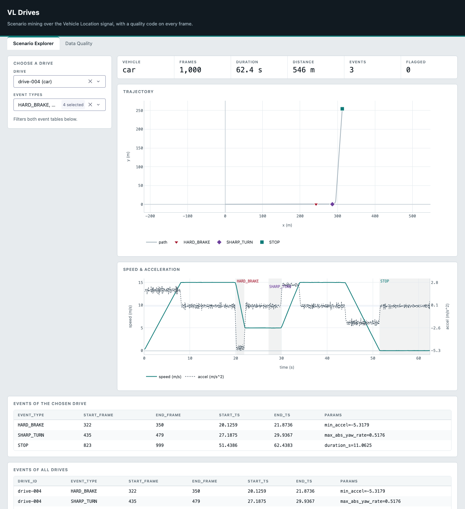

# VL Data Product

A data product built on the Vehicle Location (VL) signal: a 16 fps stream of point-cloud frames
that the pipeline ingests, validates, turns into ego-motion and driving events, stores in a
queryable warehouse, and presents in a dashboard. The use case is **scenario mining with built-in
signal-quality validation** — a data scientist searches drives for a hard brake, a sharp turn or a
stop, and every frame that fails a quality rule carries an error code explaining why.

The data is simulated by a seeded, fault-injecting drive generator; nothing here touches real
vehicle data. This is version 0.1.0 — see the [release notes](docs/release-notes.md).



*The scenario explorer on drive-004 of `make demo`: the drive's readings, the trajectory with each
event type in its own colour and symbol, speed and acceleration with the event spans shaded, and
the event table.*

```
 mock producer ──> Kafka topic vl.frames ──> Spark Structured Streaming ──> raw_frames, rejects
 (simulator)       (docker-compose)          (strict parse, centroid)        (Parquet)
                                                                                  │
                                                   Spark batch transform (per drive, pandas)
                                                   error codes, EM features, events, drive summary
                                                                                  │
                                              frames, events, drives (Parquet warehouse)
                                                                                  │
                                                  DuckDB SQL layer ──> Dash dashboard
                      standalone validator (python -m vl.validate): same rules, any source
```

## Requirements

- Docker Desktop — runs the single-node Kafka broker
- Java 17 — Spark
- Python 3.11
- A few GB of free disk (virtual environment, Kafka image, and the Spark package Spark downloads on
  the first run)
- macOS or Linux — the Makefile uses a POSIX shell; on Windows, use WSL 2

## Quick start

```
make setup      # create .venv and install requirements.txt
make check      # ruff on src and tests, mypy --strict on src
make demo       # the whole pipeline, end to end (Docker must be running)
make dashboard  # open the printed URL (http://127.0.0.1:8050)
```

`make demo` is re-runnable and takes about 75 seconds once the first run has downloaded the Spark
Kafka package (measured during review). In order, it runs:

1. `clean-data` — delete `data/warehouse` and `data/mock`
2. `kafka-reset` — a fresh broker and volumes
3. `produce` — three simulated drives of 1000 frames with four injected faults in drive-002, plus
   drive-004, the fault-free scripted scenario
4. `ingest` — Spark reads the topic into `raw_frames` and `rejects`
5. `transform` — Spark computes `frames`, `events` and `drives`
6. `validate-warehouse` — the validator reads the `raw_frames` table and checks it against the
   generator's ground-truth labels, realism checks included

It does not start the dashboard, and it leaves the broker running (`make kafka-down` stops it).

Expected output, with counts verified against the warehouse the demo wrote:

| Step | Output |
|---|---|
| produce | `sent 4000 messages from 4 drives to vl.frames` |
| ingest | `3999 raw_frames`, `1 rejects` — the one malformed message, VL-005 |
| transform | `frames: 3998` (one duplicate frame collapsed), `events: 6`, `drives: 4` |
| validate-warehouse | every line `PASS`, exit code 0; `error_code_counts: VL-001=2, VL-002=1, VL-004=1` (no VL-005 — the rejects table is not read) |

The six events are a SHARP_TURN and two STOPs in drive-002, and a HARD_BRAKE, a SHARP_TURN and a
STOP in drive-004. The scripted drive-004 exists so the demo shows the use case: the random profiles
stay below the hard-brake and hard-accel thresholds, so they produce no HARD_BRAKE, and no drive
produces HARD_ACCEL with the defaults.

When a step fails:

| Symptom | Cause and fix |
|---|---|
| `python3.11: command not found` in `make setup` | Setup needs exactly Python 3.11 on the PATH (`brew install python@3.11`, or pyenv) |
| `JAVA_GATEWAY_EXITED` or a Java error as Spark starts | Spark needs Java 17: `java -version` must show 17, or point `JAVA_HOME` at a Java 17 install |
| `error: cannot reach Kafka at localhost:9092` | Docker is not running, or another process holds port 9092; start Docker, then `make kafka-up` |
| The first `make demo` sits at the ingest step | Spark downloads its Kafka package once (internet needed); later runs reuse it |
| `ingest` adds 0 rows after the broker was recreated by hand | The checkpoint holds the old broker's offsets; `make kafka-reset` clears it |

## Other targets

| Command | What it does |
|---|---|
| `make dashboard` | Dash app over `data/warehouse` (run `make demo` first) |
| `make sanity` | Fast end-to-end sanity tests on the mock data, no Kafka (Spark local mode; about a minute) |
| `make sanity-kafka` | The same path through a real broker (needs `make kafka-up`) |
| `make generate` | Write a 5-drive mock fleet to `data/mock` (`frames.jsonl`, `labels.json`) |
| `make validate` | Validate the JSONL copy `data/mock/frames.jsonl` against its labels, with `--realism`; counts VL-005 lines |
| `make validate-warehouse` | The same checks on the `raw_frames` table (what `make demo` runs); no VL-005 |
| `make demo-v2` | The demo with message v2 (clouds in `data/clouds`, small Kafka messages); same warehouse and report |
| `make bench` | Benchmark the wire formats, the cloud codec and per-drive transform speed (about 20 s; prints a Markdown table) |
| `make produce`, `make ingest`, `make transform` | A single pipeline stage (`transform` is incremental: only changed drives) |
| `make kafka-up`, `make kafka-down`, `make kafka-reset` | Broker control (`kafka-reset` also drops its volumes and the ingest checkpoint) |
| `make clean-data` | Delete `data/warehouse`, `data/mock` and `data/clouds` |

The full test suite is `.venv/bin/pytest`: 282 tests, about 5 minutes at the last full run. The two
tests marked `integration` are deselected by default and need a running broker.

## Built for large raw data

At the assignment's resolution a frame is roughly 1M points — about 15 MB of JSON, over Kafka's
default message limit, and about 1.5 s just to decode. That makes the wire format, not the ETL, the
real engineering problem. Measured with `make bench`:

| | v1 (as first built) | now |
|---|---|---|
| Kafka message | the whole cloud as JSON (27.3 MB for the demo) | message v2: centroid + `cloud_ref` (1.2 MB for the demo) |
| Stored clouds | not kept | rigid-body codec, lossless — 28× smaller than JSON |
| Decode a 1M-point frame | 1,465 ms (JSON) | 21 ms (binary) |
| Transform rerun | every drive | only drives whose raw files changed |

On top of that: gzip and batching in the producer, bounded Kafka micro-batches, zstd Parquet, column
projection in the dashboard, and a 2.4× faster validator cloud check. The reasoning is in
[architecture.md](docs/architecture.md#scale-notes).

## Scope and judgment calls

**Why there is work beyond the brief.** The exercise allows any data source — "1000 frames, as you
wish". I took the signal resolution in the brief literally instead: at about 1M points per frame, a
JSON message is roughly 15 MB, over Kafka's default limit and about 1.3 s to decode. That turns the
wire format into the central problem, which is why message v2 and the cloud codec exist. Every number
behind that decision comes from `make bench`.

**Deliberately left out:**

- **Clips.** The product diagram shows them as a second output of Data Collection, going straight to
  the catalog; the exercise asks for the VL-signal path. `drive_id` plus an event's time range are
  the join keys a clip catalog would use ([assumptions](docs/architecture.md#assumptions)).
- **Vertical motion.** The centroid's `z` is stored but unused. Every event in this use case is
  planar and the simulated roads are flat, so vertical kinematics would only measure noise.
- **A cross-drive vectorised transform.** Proposed, profiled, then dropped — the ~54 ms fixed cost
  per drive amortises to nothing on a realistic hour-long drive (33.8k → 404k rows/s, `make bench`).

**One architectural gap, stated plainly.** Message v2 writes one cloud file per drive before the
first message is sent, so it proves the size and decode wins but is not yet true per-frame streaming
([details](docs/architecture.md#message-v2-the-claim-check)).

## Command line

Every command runs from the repo root through the Makefile, which sets `PYTHONPATH=src`. To run one
by hand: `PYTHONPATH=src .venv/bin/python -m <module> ...`.

| Stage | Command |
|---|---|
| generate | `python -m vl.mock.generate --drives 5 --frames 1000 --seed 0 --out data/mock` |
| producer | `python -m vl.mock.producer --drives 3 --frames 1000 --seed 0 --faults demo --scripted --bootstrap localhost:9092 --out-dir data/mock` (`--scripted` appends the scenario drive; `--cloud-dir DIR` sends message v2; also `--faults none`, `--rate-fps 16`, `--topic`) |
| ingest | `python -m vl.etl.ingest --kafka --bootstrap localhost:9092 --topic vl.frames --warehouse data/warehouse` (or `--source-dir DIR` for files; `--checkpoint DIR`) |
| transform | `python -m vl.etl.transform --warehouse data/warehouse [--incremental]` |
| bench | `python -m vl.bench [--quick]` |
| validate | `python -m vl.validate --source data/mock/frames.jsonl --labels data/mock/labels.json --realism` (the source can also be a `raw_frames` Parquet directory; `--realism` needs `--labels`) |
| dashboard | `python -m vl.dashboard.app --warehouse data/warehouse [--port 8050] [--host 127.0.0.1]` |

Validator exit codes: 0 all checks passed, 1 a check failed, 2 unusable input. See
[docs/error-codes.md](docs/error-codes.md).

## Repository layout

```
Makefile, docker-compose.yml     one-command workflow, single-node Kafka (KRaft)
requirements.txt, pyproject.toml pinned dependencies, ruff and mypy --strict settings
src/vl/
  config.py, errors.py, schemas.py   thresholds (Config), ErrorCode/EventType, table schemas
  validation.py                      the validator: every error-code rule and the report checks
  validate.py                        validator CLI (JSONL or Parquet source, labels, realism)
  kafka_io.py                        message encoding, publishing, broker checks
  claim_check.py, cloud_codec.py     message v2 (centroid + cloud_ref) and the rigid-body cloud codec
  bench.py                           the benchmark behind the scaling numbers
  spark.py                           shared Spark session factory
  warehouse.py                       DuckDB views over the Parquet tables, EXAMPLE_QUERIES
  mock/                              drive simulator, profiles, vehicles, faults, generate, producer
  etl/                               features.py (pure pandas logic), ingest.py, transform.py (Spark),
                                     incremental.py (what changed since the last transform)
  dashboard/                         figures.py (Plotly), app.py (Dash)
tests/                               unit, golden-fixture, hardening, sanity and integration tests
docs/                                architecture, error codes, release notes, prompt log
data/                                generated at run time (git-ignored)
```

## Configuration

Every threshold is a field of `vl.config.Config`, overridable with a `VL_<FIELD>` environment
variable (for example `VL_MAX_JUMP_M=5 make transform`). `load_config()` validates the values
(finite, in range); the validator CLI reports a bad value as a one-line error and exits 2.

| Field (env var `VL_<FIELD>`) | Default | Used for |
|---|---|---|
| `frame_period_s` | 0.0625 | nominal frame period (16 fps); STOP duration |
| `max_jump_m` | 3.0 | VL-002 position jump |
| `max_accel_ms2` | 15.0 | VL-003 impossible acceleration |
| `min_cloud_points` | 50 | VL-006 sparse cloud |
| `smooth_frames` | 5 | smoothing window for speed and heading |
| `hard_brake_ms2` / `hard_accel_ms2` | -3.5 / 3.0 | HARD_BRAKE / HARD_ACCEL events |
| `sharp_turn_rad_s` | 0.35 | SHARP_TURN event |
| `stop_speed_ms` / `stop_min_s` | 0.2 / 2.0 | STOP event |
| `min_event_frames` | 4 | shortest reportable event |
| `yaw_min_speed_ms` | 0.5 | below this speed the yaw rate is 0 |
| `max_flag_rate` | 0.05 | validator limit on the share of flagged frames |
| `max_false_positive_rate` | 0.01 | validator limit on flags among unlabeled frames |
| `realism_percentile` | 0.99 | percentile used by the realism checks |

`VL_KAFKA_BOOTSTRAP` (default `localhost:9092`) is the broker address for the producer and the
ingest. The Kafka topic is `vl.frames`.

## Documentation

- [docs/architecture.md](docs/architecture.md): use cases, architecture, data model, technology
  choices and alternatives, reliability, data quality, scale, cloud mapping, testing
- [docs/error-codes.md](docs/error-codes.md): the error codes VL-001 to VL-006, event types, exit codes
- [docs/release-notes.md](docs/release-notes.md): version 0.1.0, usage, known issues, coming soon
- [docs/PROMPTS.md](docs/PROMPTS.md): how the LLM was used (model, prompts, approach)
